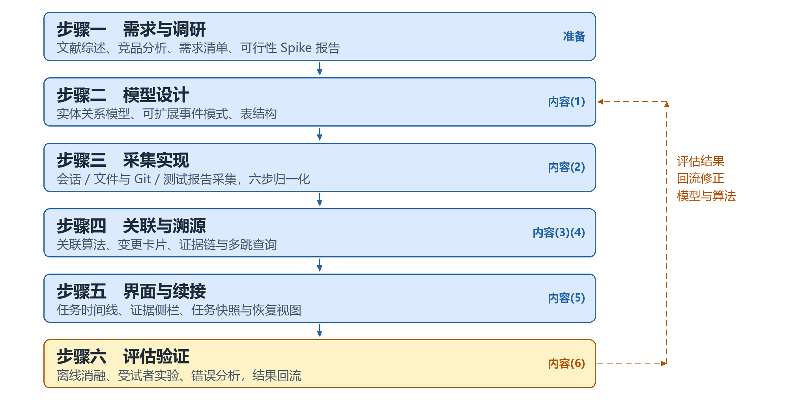
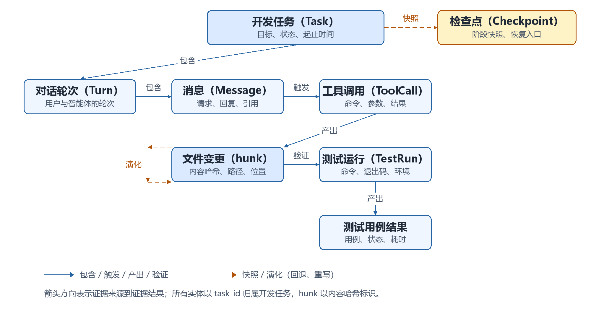
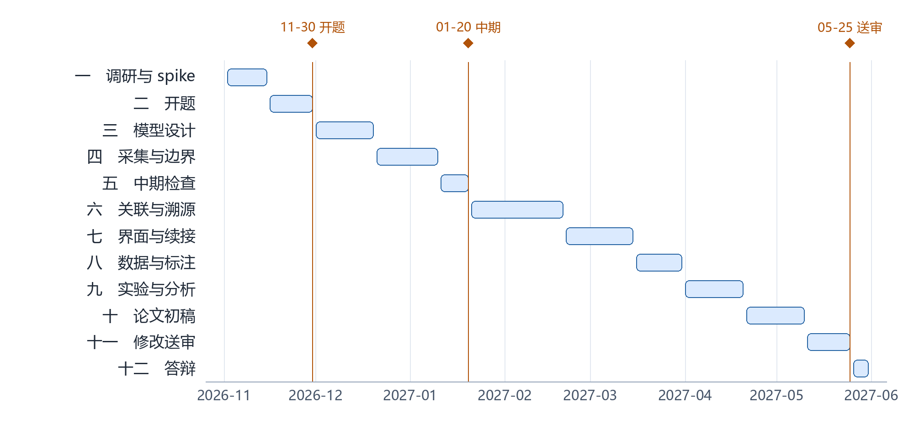

<!--
  本文件是《本科毕业设计（论文）开题报告》的可编辑 Markdown 镜像，与 LaTeX 版逐段对应。
  由 scripts/tex2md.py 从 latex/chapters/proposal_body.tex 生成；
  封面信息取自 latex/chapters/metadata.tex。
  改稿约定见 AGENTS.md 第 7 节：先改本文件，再同步 tex；tex 改动后重新运行本脚本。
  校验：python scripts/tex2md.py --check
-->

# 本科毕业设计（论文）开题报告

## 封面信息

> 封面字段来自 `latex/chapters/metadata.tex`；改封面信息请改该文件，不要只改本镜像。

| 项目     | 内容                                                           |
| -------- | -------------------------------------------------------------- |
| 课题名称 | 面向代码智能体的开发任务上下文追踪与代码变更溯源系统设计与实现 |
| 副标题   | （无）                                                         |
| 学院     | 计算机科学与技术学院                                           |
| 专业     | 计算机科学与技术                                               |
| 学生姓名 | 王奕博                                                         |
| 学号     | 2353945                                                        |
| 日期     | 年　月　日（封面留空，手写）                                   |

## 摘要

开发者借助代码智能体完成代码修改、执行与测试已成为常态，但对话、变更、工具调用与测试结果分散，缺少以开发任务为中心的组织，导致在连续长周期的开发任务中无法判断智能体的修改原因与证据依赖。本课题面向单个开发者，研究任务、对话、变更、工具调用与测试之间的关联与组织方法，设计并实现支持任务上下文追踪与变更溯源的原型，并从概念与模型、采集与关联、溯源与续接、评估四个方面提出初步实施方案。

**关键词**：代码智能体；任务上下文；变更溯源；中断恢复；证据链

## 一、毕业设计（论文）课题背景

### 1．课题来源及研究的目的和意义

近年来，代码智能体（code agent）逐渐应用于日常软件开发。开发者以自然语言描述任务，由智能体完成代码分析、文件修改、工具调用、测试执行与问题排查。与代码补全相比，智能体的输出从一段预测性质的代码块，转变为一组带有工具调用与执行反馈的操作序列；使用智能体的开发过程从使用智能体完成代码，转变为开发者发出指令、智能体实施操作、开发者审查验证的人机协作过程。这一转变在提高任务吞吐的同时，也使对智能体开发过程持续性的理解与核查成为开发者必须面对的问题。

现有工具通常将过程信息分散于不同界面或不同类型的记录之中，智能体对话消息留存于会话窗口，代码差异留存于 diff 视图，工具调用留存于终端或工具日志，测试结果留存于测试报告，版本演化留存于 Git 历史。然而，智能体开发工具往往在底层缺乏统一的状态建模与上下文管理机制，导致以上的过程信息在逻辑上相互割裂。由此产生三方面问题：一是缺乏结构化的任务状态追踪，导致多轮修改、多任务并行与中断重启后难以掌握全局进展；二是缺乏细粒度的变更溯源机制，代码修改与触发它的指令、验证它的测试结果之间未能建立因果关联，导致修改原因难以回溯；三是缺乏执行轨迹的持久化与恢复能力，导致中断后上下文丢失，重新开始只能依赖低效地重读长对话与大量差异。

本课题面向单个开发者使用代码智能体完成开发任务的场景，研究开发任务、对话、代码变更、工具调用与测试结果之间的关联与组织方法，设计并实现支持任务上下文追踪与变更溯源的原型，使开发者能够围绕任务、文件或代码片段审阅智能体的修改原因与依据，并在任务中断后据此恢复必要的上下文。

### 2．文献综述

#### （一）智能体开发的过程记录

开发者在使用代码智能体时，通过对话的形式将开发任务派发到智能体，智能体在经过编写、修改、执行等一系列动作过程完成任务。因此，执行过程的记录是任务溯源的重要依据。早期代码智能体的评测与实践主要关注最终结果，执行过程并未被系统性地保留下来。如SWE-bench[1]研究的基准把问题单、代码修改与测试结合起来，根据真实代码仓库issue构建任务，以补丁同时通过 FAIL_TO_PASS（修复验证）与 PASS_TO_PASS（回归保持）测试的任务比例作为解决率。该方法把对智能体工具链调用效果的评价压缩为根据项目测试通率进行的综合评分指标，为代码智能体综合能力的评估提供了一个基准方法；但其间智能体的过程信息仍处于被执行而不被使用的状态，尚未纳入评价体系。SWE-agent[2]研究在此之上进行了改善，将智能体软件开发问题重新框定为智能体与代码库之间的多轮交互过程，并提出 Agent-Computer Interface（ACI）作为连接语言模型与执行环境的抽象层。该研究为模型规定了搜索、查看、编辑等专用命令，并将模型的推理、动作和反馈进行记录，使智能体的执行过程成为可追溯的结构化数据。此时的智能体过程通过完成任务后以类似日志的形式被记录。OpenHands[3]进一步推动在架构中实现内生地过程记录。它以事件流的记录方式取代传统的状态快照与扁平轨迹，事件流成为系统状态与交互历史的核心记录方式，且每个 observation 显式链接回触发它的 action，动作与反馈之间的因果关系由此内生于数据结构本身。在智能体过程记录的迭代过程中，轨迹数据逐渐清晰化，但记录仍主要服务于系统运行、重放与事后统计，而非主动性的溯源工作上。

开发者在使用大模型进行开发时同样留下了可分析的过程数据。Mozannar 等[4]结合 Copilot 的遥测日志与回顾性视频标注，将开发者使用代码建议系统时的活动细分为验证建议、编辑建议、提示工程等状态，并发现验证建议是耗时最长的单项活动。这表明开发者侧的阅读、验证与修正并非可有可无的环节，其交互记录也具备过程分析价值。开发者侧的交互记录与智能体侧的执行轨迹尚未有效关联，二者既没有共享的可跨会话延续的“任务”层，也未与同一组具体代码变更块建立对应关系。由此，智能体侧与开发者侧虽已积累日益丰富的过程记录，却尚未形成将其组织到“任务”层并关联至具体代码变更块的统一机制。

#### （二）变更与任务上下文的组织单位与粒度

变更记录的单位经历了由粗到细的推进。基于提交的缺陷回溯方法借助 diff 注释与行级历史追踪，将“修复”与“引入”关联至提交及其代码行[8]，使变更与致因之间形成可计算的对应关系。然而，提交是版本控制的单位，而非开发者意图的单位；单次提交可能混杂多重意图，触发该提交的指令也不在记录范围之内。在仓库挖掘综述[9]中，研究者进一步给出表示单位的分布。多数研究以文件或行号为表示单位，以提交与缺陷库为信息来源，而修改记录与缺陷报告之间得以建立关联的比例较低。这可能表明，粒度与信息源共同限定了可关联性的上限，单位越粗，可绑定的证据越少；单位越细，对稳定位置标识的依赖越强。代码—仓库关联图方法进一步把代码实体与提交、缺陷、邮件相互索引形成网状结构[10]，使代码与记录的相关性可以进行静态的历史索引查询，关联对象以提交与仓库实体为主，变更的触发来源与验证依据不在表示范围内。

任务上下文的单位问题也见于中断恢复研究。Parnin 与 Rugaber 将任务上下文视为恢复工作的核心对象，其对相关工具的评述指出，按任务过滤代码元素的工具有助于找回任务所需的对象，但往往不能支持规划后续步骤或评估已完成进度[11]。该研究以空闲时长切分会话，据此指出会话与任务并非一一对应，任务边界须另行界定；研究同时发现，多数会话在首次编辑之前需先导航至其他位置，而源代码差异因能显示已完成部分并支撑进度判断，被视为有效的恢复线索[11]。此外，上述工作共同隐含一个前提，即变更由开发者直接实施，其触发来源可从提交信息、编辑操作或任务清单中就近获取，而在智能体参与开发的情境下，变更的实施主体由开发者转为智能体，使触发来源与验证依据进一步脱离版本库与 IDE 的可及范围。

#### （三）过程溯源与工具现状：证据链的三处缺口

对任务的过程溯源除了依托记录外，还需要记录带有显式的派生关系。W3C 的 PROV-O 是为这一问题设计的通用语法，它把过程拆为实体（Entity）、活动（Activity）与代理（Agent），以“活动使用实体、活动产出实体、实体归属代理”刻画三者关系[12]。该方法的抽象层次比较高，为本课题提供了一个比较基础的方法参考。Souza 等的 PROV-AGENT 在 PROV 的基础上扩展，新增智能体、工具调用与模型调用等类，把提示、响应、决策和数据对象纳入同一张图，并用 used、wasGeneratedBy、wasInformedBy 等关系连接[13]。其一次决策可以一路回溯到最初的输入数据，因此在智能体交互方面相比PROV-O更细化。脚本执行溯源工具则以内容寻址标识和一次执行（trial）为单位，支持差异比较、状态恢复与历史查询[14]。这些工作表明过程可以被记录与查询，但其对象是数据、脚本状态或交互元数据，尚未与代码变更块建立派生关系。工程工具一侧，有的客户端以会话为单位保存历史并提供恢复入口[15]，但未提供与变更、测试绑定的证据链。由此可归纳出三处缺口：组织单位上，缺少“由开发者提出、可跨会话延续”的任务层；变更粒度上，文件或行均未达到可与证据绑定的变更块级；验证依据上，测试主要作为评测判据，未进入“某次修改依据哪次测试”的可查询表示。本课题即以这三点为切入点：以任务为根、以变更块为粒度、把测试运行纳入证据链。

## 二、毕业设计（论文）方案介绍

### 1．研究问题与研究内容

本课题关注的核心问题是：单个开发者使用代码智能体完成开发任务时，如何将分散于对话、变更、工具调用与测试记录中的过程信息组织起来，使之可追溯、可核查，并在任务中断后支持上下文恢复。该问题包含三个相互关联的方面：一是采用何种信息模型统一表示异构记录，使任务、对话、变更、执行与测试之间能够建立稳定关联；二是依据哪些线索将上述记录归并到具体任务，并判定任务的起止边界；三是如何围绕代码变更组织证据、呈现任务进展，并在中断后恢复必要的上下文。三者分别对应表示、关联与恢复三个层面，评估则贯穿其中。研究方法上，拟采用文献分析、模型设计、原型实现与实证评估相结合的方式，先建立表示与关联方法，再通过原型检验其可用性。

围绕上述问题，本课题的研究内容主要包括五个方面。一是任务上下文的信息模型与统一事件表示，抽象开发任务、对话轮次、消息、工具调用、文件变更、测试运行、测试用例结果与检查点等实体及其关系，设计可扩展的事件模式，使不同来源的记录进入同一表示框架。二是上下文采集与关联，接入代码智能体的会话与工具调用、文件系统与 Git、测试报告，将编辑动作归一化为变更块，并利用时间邻近、显式引用与文件级位置映射等线索建立变更与对话之间的多对多关联。三是变更溯源与证据链，以变更块为单位记录触发来源、实施过程、修改前后快照、验证依据与后续演化，支持从代码到原因、从原因到代码的双向查询。四是交互界面与任务续接，设计任务中心、任务时间线与变更证据侧栏等视图，并在任务中断后生成任务快照，呈现已完成、未完成与待验证事项。五是大语言模型辅助与评估，在证据绑定约束下生成任务摘要与进展整理，并通过典型编程任务考察系统在代码理解、修改原因分析与任务衔接方面的作用。

### 2．初步实施方案

本课题的初步实施方案按“概念与模型—采集与关联—溯源与续接—评估”四个模块组织。四个模块对应研究推进的不同环节：概念与模型回答“表示什么”，采集与关联回答“如何获得并建立联系”，溯源与续接回答“如何查询与使用”，评估回答“方案是否有效”。四者并非软件工程的层次划分，而是相互约束的研究环节，其关系如图 2-1 所示。

#### （一）概念框架与信息模型

本模块界定开发任务、任务上下文与变更溯源三个核心概念，并提出可计算的信息模型。开发任务指开发者发起的一次有明确目标的开发工作单元；任务上下文指与该任务相关的对话、变更、执行、测试、决策与未完成事项的集合；变更溯源指从一段代码变更出发，追溯其触发来源、实施过程、验证依据与后续演化的证据链。在此基础上，将任务上下文刻画为以任务为根的有向异构图：节点包括任务、对话轮次、消息、工具调用、文件变更（含变更块）、测试运行、测试用例结果与检查点，边包括包含、触发、产出、验证、演化与快照等关系，其基本结构如图 2-2 所示。以任务为根而非以会话或文件为根，是为了让跨会话、跨文件的记录围绕同一目标聚合，并为后续的边界判定与证据查询提供统一入口。该模型与 PROV-O[12] 的基本思想一致，但针对智能体事件流增加了任务边界、变更块与验证依据等约束。事件采用统一的 JSON 结构表示，字段涵盖标识、类型、时间、主体、来源、载荷与关联；模型需满足变更标识稳定、消息与变更多对多、测试结果双向指向等基本约束。上述概念与模型为后续采集、关联与查询提供共同语言，其具体表结构与索引方式将在原型实现阶段细化。

#### （二）上下文采集、关联与任务边界

本模块研究如何从真实开发过程中获得上述实体，并建立它们之间的关联。采集对象包括代码智能体的会话与工具调用、文件系统与 Git 变更、测试运行与结果；接入方式以 Claude Code 的官方钩子与 stream-json 为主，本地日志与 Git 作为补充。由于不同工具的编辑动作形式不一，需要将“旧串→新串”、补丁、整文件写入等统一归一化为变更块；语法感知的符号定位可借助 tree-sitter[16] 一类解析器完成。关联层面，拟综合利用时间邻近、显式引用（路径、符号、行号、命令、测试名）与文件级位置映射三类线索，为每条消息与每个变更块计算关联强度。由于同一变更可能由多轮消息共同促成，关联结果保留置信度与多对多关系，而不强行归并为单一来源。任务边界判定则依据空闲时长、显式指令、目标切换与提交动作等特征，采用可解释的规则打分，以便向开发者说明判定依据。该模块的重点不在于追求单点最优，而在于形成一套可复现、可解释的关联流程，其参数与阈值将在小规模验证集上调整并报告敏感性。

#### （三）变更溯源与任务续接

本模块将前两个模块的表示与关联转化为开发者可查询、可使用的证据链。对每个变更块生成变更卡片，记录触发消息、相关工具调用、修改前后快照、验证测试与后续演化；查询支持从代码到原因、从原因到代码两个方向。任务续接以任务快照为核心：快照由任务上下文图生成，将事项分为已完成、未完成与待验证三类，并附带指向证据的链接，使开发者能够从摘要直接跳转到对应的消息、变更或测试结果。原型拟采用 Web 形态，提供任务中心、任务时间线与变更证据侧栏三个视图；文件与代码片段视角作为时间线的过滤与详情，不单独作为第四视图。三个视图分别回答“当前有哪些任务”“任务经过了什么”“某处变更依据何在”，共同构成从任务到证据的浏览路径。大语言模型用于生成任务摘要与进展整理，但输出须绑定证据标识，证据不足时弃答，以降低无依据结论的风险。

#### （四）评估方案

本模块检验前三个模块的构想是否可行。研究定位为小样本探索性预研，不追求确证性结论。离线评测拟在 2 个中小规模开源仓库的 6—8 个任务上进行，任务覆盖缺陷修复、功能新增与代码重构，其中部分可改写自 SWE-bench 与 SWE-rebench[17] 的真实 issue；考察关联准确率、任务边界判定 F1、溯源查询正确率与查询响应时间等指标。用户研究拟招募 4—5 名具备编程经验的同专业学生，在自我中断情境下比较“Git 日志 + 原始会话记录”与“完整系统”两种条件，观察恢复用时、理解要点命中数与问题定位用时，并以 SUS[18] 作为可用性指标，NASA-TLX[19] 作为可选的认知负荷观察。受样本量限制，结果以描述统计与逐人差值呈现，不设显著性结论；同时通过任务构造与评测分离、第三方招募、数据脱敏等方式控制实验者偏差与伦理风险。离线指标用于检验方法的客观正确性，用户研究用于观察其在真实恢复情境中的可用性，二者互为补充。

四个模块的推进顺序为：先完成概念与模型、采集与关联的方法设计，再实现溯源与续接原型，最后开展评估，并将评估结果反馈至模型与方法。各模块的阶段性产出作为下一模块的输入，具体任务与周次见下文进度安排。

<!-- pagebreak -->

### 3．工作进度安排

本课题按任务书的教学周安排推进，六个阶段如表 2-1 与图 2-3 所示。第 9 周进行开题答辩，开题材料在第 8 周前完成；中期检查与答辩按学院统一安排。时间安排以教学周计，具体以学院通知为准。

表 2-1 研究进度安排

| 阶段                  | 教学周 | 主要工作                                                           |
| --------------------- | ------ | ------------------------------------------------------------------ |
| 1　文献研究与产品调研 | 1—8    | 文献综述；确定研究问题、评价标准与实验任务；完成开题报告与答辩准备 |
| 2　关键方法设计与实现 | 9—14   | 信息模型与事件模式、编辑动作归一化、关联与边界判定、证据链查询     |
| 3　系统设计与实现     | 15—20  | 三个视图、任务快照与续接、大模型摘要与证据校验、原型集成           |
| 4　系统验证与测试     | 21—22  | 6—8 个典型任务实验、4—5 人试点、错误分析与效度检查                 |
| 5　毕业设计论文撰写   | 23—28  | 实验分析、论文初稿、图表与复现材料                                 |
| 6　论文审阅与修改     | 29—32  | 论文修改、查重、定稿与答辩材料                                     |

<!-- pagebreak -->

## 三、毕业设计（论文）的主要参考文献

（说明：会议文献按 GB/T 7714-2015 著录，出版地与出版者从略；网络资源引用日期统一为 2026-10-27。）

[1] JIMENEZ C E, YANG J, WETTIG A, et al. SWE-bench: can language models resolve real-world GitHub issues?[C]//Proceedings of the 12th International Conference on Learning Representations. 2024. arXiv: 2310.06770.

[2] YANG J, JIMENEZ C E, WETTIG A, et al. SWE-agent: agent-computer interfaces enable automated software engineering[C]//Advances in Neural Information Processing Systems 37. 2024. arXiv: 2405.15793.

[3] WANG X, LI B, SONG Y, et al. OpenHands: an open platform for AI software developers as generalist agents[C]//Proceedings of the 13th International Conference on Learning Representations. 2025. arXiv: 2407.16741.

[4] 张犬俊, 谢杨, 房春荣, 等. 检索增强生成在软件工程中的应用综述[J]. 软件学报, 2026, 37(3): 1316-1339. DOI: 10.13328/j.cnki.jos.007567.

[5] 汪莹, 字千成, 彭鑫, 等. 基于大语言模型的故障复现测试用例生成方法[J]. 软件学报, 2026, 37(4): 1690-1714. DOI: 10.13328/j.cnki.jos.007474.

[6] MOZANNAR H, BANSAL G, FOURNEY A, et al. Reading between the lines: modeling user behavior and costs in AI-assisted programming[C]//Proceedings of the CHI Conference on Human Factors in Computing Systems. 2024: 1-16. DOI: 10.1145/3613904.3641936.

[7] PERRY N, SRIVASTAVA M, KUMAR D, et al. Do users write more insecure code with AI assistants?[C]//Proceedings of the 2023 ACM SIGSAC Conference on Computer and Communications Security. 2023: 2785-2799. DOI: 10.1145/3576915.3623157.

[8] ŚLIWERSKI J, ZIMMERMANN T, ZELLER A. When do changes induce fixes?[C]//Proceedings of the 2005 International Workshop on Mining Software Repositories. 2005: 1-5. DOI: 10.1145/1083142.1083147.

[9] KAGDI H, COLLARD M L, MALETIC J I. A survey and taxonomy of approaches for mining software repositories in the context of software evolution[J]. Journal of Software Maintenance and Evolution: Research and Practice, 2007, 19(2): 77-131. DOI: 10.1002/smr.344.

[10] BEGEL A, KHOO Y P, ZIMMERMANN T. Codebook: discovering and exploiting relationships in software repositories[C]//Proceedings of the 32nd ACM/IEEE International Conference on Software Engineering. 2010: 125-134. DOI: 10.1145/1806799.1806821.

[11] PARNIN C, RUGABER S. Resumption strategies for interrupted programming tasks[J]. Software Quality Journal, 2011, 19(1): 5-34. DOI: 10.1007/s11219-010-9104-9.

[12] W3C. PROV-O: the PROV ontology[EB/OL]. (2013-04-30)[2026-10-27]. https://www.w3.org/TR/prov-o/.

[13] SOUZA R, GUEROUDJI A, DEWITT S, et al. PROV-AGENT: unified provenance for tracking AI agent interactions in agentic workflows[C]//Proceedings of the 21st IEEE International Conference on e-Science. 2025. arXiv: 2508.02866.

[14] PIMENTEL J F, MURTA L, BRAGANHOLO V, et al. noWorkflow: a tool for collecting, analyzing, and managing provenance from Python scripts[J]. Proceedings of the VLDB Endowment, 2017, 10(12): 1841-1844. DOI: 10.14778/3137765.3137789.

[15] Anthropic. Claude Code documentation: overview[EB/OL]. [2026-10-27]. https://code.claude.com/docs/en/overview.

[16] Tree-sitter. Tree-sitter documentation[EB/OL]. [2026-10-27]. https://tree-sitter.github.io/tree-sitter/.

[17] BADERDINOV I, GOLUBEV A, NEKRASHEVICH M, et al. SWE-rebench: an automated pipeline for task collection and decontaminated evaluation of software engineering agents[EB/OL]. (2025-05-26)[2026-10-27]. https://arxiv.org/abs/2505.20411.

[18] BROOKE J. SUS: a quick and dirty usability scale[M]//JORDAN P W, THOMAS B, WEERDMEESTER B A, et al. Usability Evaluation in Industry. London: Taylor & Francis, 1996: 189-194.

[19] HART S G, STAVELAND L E. Development of NASA-TLX (Task Load Index): results of empirical and theoretical research[J]. Advances in Psychology, 1988, 52: 139-183. DOI: 10.1016/S0166-4115(08)62386-9.

<!-- pagebreak -->

## 四、审核意见

> **指导教师意见：**（课题难度是否适中、工作量是否饱满、进度安排是否合理、工作条件是否具备、是否同意开题等）
>
> 指导教师签名：________________　　　　年　　月　　日

> **专业审核意见：**（适当对各项内容给与意见和评价，字数不限。）
>
> 负责人签名：________________　　　　年　　月　　日
